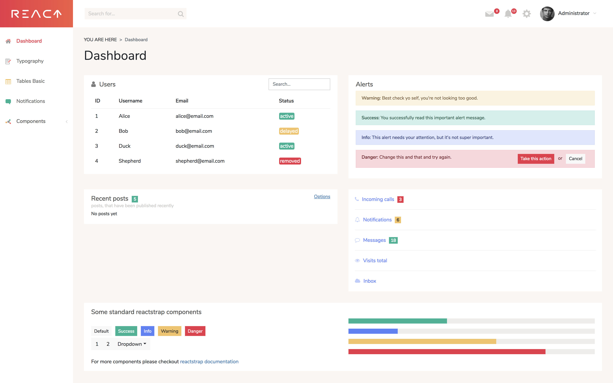

# React Dashboard Template

Modern dashboard starter rebuilt on top of `Vite`, `React 19`, `React Router 7`, `Redux Toolkit`, `Bootstrap 5`, and `TypeScript` tooling.



## Stack

- `React 19`
- `Vite 8`
- `React Router 7` data router
- `Redux Toolkit 2`
- `Bootstrap 5` + `reactstrap`
- `Recharts`
- `Vitest` + Testing Library
- `ESLint 9` flat config

## What is included

- Modern app shell with lazy routes and route guards
- Demo authentication flow backed by local session storage
- Demo posts module powered by Redux Toolkit slices
- Bootstrap icon explorer, dashboard widgets, charts, tables, notifications, and maps
- SCSS theme layer adapted to Bootstrap 5

## Requirements

- `Node.js 22.12+`
- `npm 10+`

## Getting started

```bash
npm ci
npm run dev
```

The app starts with Vite and is available on the local URL printed in the terminal.

## Demo access

Use the built-in local demo account on the login screen:

```text
user / password
```

## Scripts

```bash
npm run dev
npm run build
npm run preview
npm run lint
npm run typecheck
npm run test
npm run test:watch
```

- `npm run dev` starts the Vite development server.
- `npm run build` runs TypeScript checks and creates the production bundle.
- `npm run preview` serves the built bundle locally after `npm run build`.
- `npm run lint` runs ESLint.
- `npm run typecheck` runs TypeScript without emitting files.
- `npm run test` runs the Vitest suite once.
- `npm run test:watch` starts Vitest in watch mode.

## Environment variables

Create a local `.env` file only when you need one of these optional behaviors:

```bash
# optional: switch the maps page to Google Maps instead of the built-in OSM fallback
VITE_GOOGLE_MAPS_API_KEY=your_api_key

# optional: deploy the app under a sub-path, for example /react-dashboard/
VITE_BASE_PATH=/your-base-path/
```

- Without `VITE_GOOGLE_MAPS_API_KEY`, the maps demo automatically falls back to an embedded OpenStreetMap view.
- Use `VITE_BASE_PATH` only when the app is deployed under a sub-path instead of the site root.

## Project notes

- The legacy CRA, GraphQL demo backend, old Redux setup, and browser JWT/polyfill hacks were removed.
- The template keeps demo data local by default so it can run without a backend.
- The app root redirects to `/login` for guests and to `/app/main` for active demo sessions.
- The active local workflow is `npm ci` + `npm run dev`; there is no `npm start` script in this template.
- Use the committed `package-lock.json` for reproducible dependency installs. The legacy `yarn.lock` has been removed.
