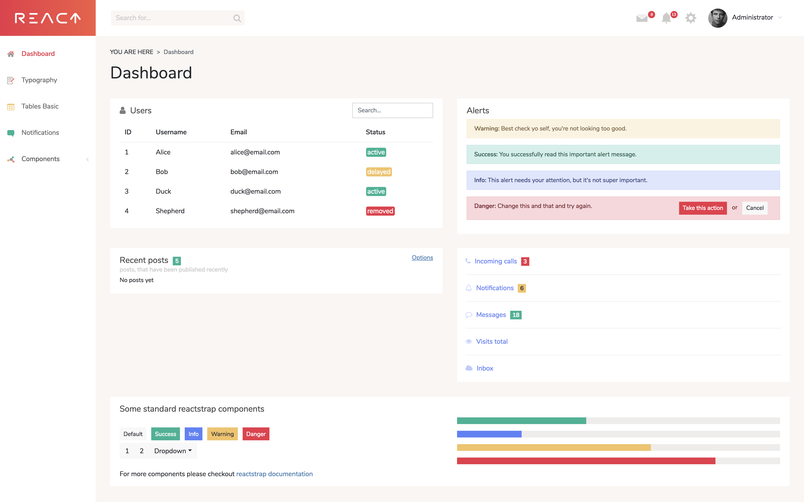

# React Dashboard Template

Modern dashboard starter rebuilt on top of `Vite`, `React 19`, `React Router 7`, `Redux Toolkit`, `Bootstrap 5`, and `TypeScript` tooling.



## Stack

- `React 19`
- `Vite 8`
- `React Router 7` data router
- `Redux Toolkit 2`
- `Bootstrap 5` + `reactstrap`
- `Recharts`
- `Vitest` + Testing Library
- `ESLint 9` flat config

## What is included

- Modern app shell with lazy routes and route guards
- Demo authentication with local sessions or an optional cookie-based server
- Posts backed by local demo data or the existing SQLite database through GraphQL
- Bootstrap icon explorer, dashboard widgets, charts, tables, notifications, and maps
- SCSS theme layer adapted to Bootstrap 5

## Requirements

- `Node.js 24+`
- `npm 10+`

## Getting started

```bash
npm ci
npm run dev
```

The app starts with Vite and is available on the local URL printed in the terminal.

## Demo access

Use the built-in local demo account on the login screen:

```text
user / password
```

## Scripts

```bash
npm run dev
npm run build
npm run preview
npm run lint
npm run typecheck
npm run test
npm run test:watch
```

- `npm run dev` starts the Vite development server.
- `npm run build` runs TypeScript checks and creates the production bundle.
- `npm run preview` serves the built bundle locally after `npm run build`.
- `npm run lint` runs ESLint.
- `npm run typecheck` runs TypeScript without emitting files.
- `npm run test` runs the frontend and backend integration tests.
- `npm run test:watch` starts Vitest in watch mode.
- `npm run server` serves the built app and authenticated API on port 5000.
- `npm run db:init` explicitly creates a new, empty SQLite database; it refuses to modify an existing file.

## Server mode: login and GraphQL

The static demo remains the default. To use the server, create an untracked `.env.local`:

```dotenv
VITE_BACKEND=true
JWT_SECRET=replace-with-a-long-random-secret
DATABASE_URL=sqlite:database.sqlite
```

For a **new local database only**, run `npm run db:init`. Then run `npm run build` and `npm run server`, and open `http://localhost:5000`. For development, keep the server running and use `npm run dev` in another terminal; Vite proxies the API to port 5000. `npm run preview` only serves static assets and does not run the API.

Server mode keeps the deployed demo credentials (`user` / `password`), the `id_token` cookie, and the existing GraphQL queries: `me`, `posts`, and `news`. Authentication uses an HttpOnly cookie; the frontend does not store the JWT. `/session` validates the cookie on page entry, and `POST /logout` clears it. Login still returns `id_token` for existing API clients. Mutations remain disabled, as they were in the deployed backend; the server UI shows posts as read-only. Registration is not supported by the demo.

The server reads the legacy `Post` table without altering the database. Missing databases or tables stop startup with an error. The `news` query retains the external RSS provider and reports provider errors through GraphQL.

### Preparing a deployment

The Dockerfile builds the UI with `VITE_BACKEND=true` and starts the API on port 5000 using Node 24. It does not create a database or supply a JWT secret. Server mode is served at the site root; `VITE_BASE_PATH` is for the static demo.

Before a future deployment:

1. Preserve the existing `JWT_SECRET` so old HS256 login cookies remain valid. Supply it at runtime, never as a `VITE_` variable or build argument.
2. Back up and retain the existing database volume. Mount it at `/data` and set `DATABASE_URL=sqlite:/data/database.sqlite`. Do not replace an existing database with demo data.
3. If the volume has no database, explicitly initialize it with `node server/init-db.mjs` in a one-off container mounting that volume. Initialization is never automatic.
4. Keep HTTPS at the reverse proxy. The image sets `NODE_ENV=production`, enabling Secure cookies. Preserve the container's proxy network and port 5000 routing.
5. Retain the old image and deployment configuration for rollback. Verify login, session restoration, logout and authenticated GraphQL before switching traffic.

No deployment is performed by the package scripts.

## Environment variables

Create a local `.env` file only when you need one of these optional behaviors:

```bash
# optional: switch the maps page to Google Maps instead of the built-in OSM fallback
VITE_GOOGLE_MAPS_API_KEY=your_api_key

# optional: deploy the app under a sub-path, for example /react-dashboard/
VITE_BASE_PATH=/your-base-path/
```

- Without `VITE_GOOGLE_MAPS_API_KEY`, the maps demo automatically falls back to an embedded OpenStreetMap view.
- Use `VITE_BASE_PATH` only when the app is deployed under a sub-path instead of the site root.

## Project notes

- The legacy CRA toolchain, old Redux setup, and browser JWT/polyfill hacks were removed. The optional backend preserves the deployed login and GraphQL query contract using current dependencies.
- The template keeps demo data local by default so it can run without a backend.
- The app root redirects to `/login` for guests and to `/app/main` for active demo sessions.
- The active local workflow is `npm ci` + `npm run dev`; there is no `npm start` script in this template.
- Use the committed `package-lock.json` for reproducible dependency installs. The legacy `yarn.lock` has been removed.
- The scoped `minimatch` override fixes [GHSA-g3hv-75wg-m249](https://github.com/advisories/GHSA-g3hv-75wg-m249) in the TypeScript ESLint dependency chain. Remove it when that dependency requires a patched version itself. `node-forge` is no longer in this dependency tree.
